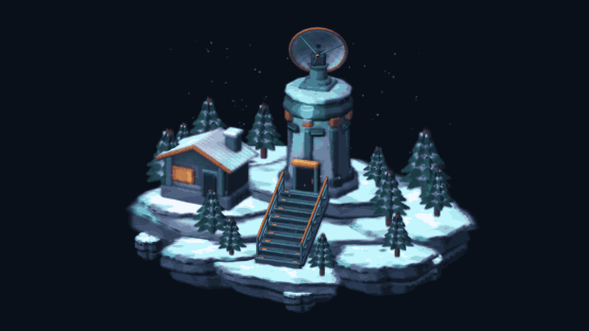
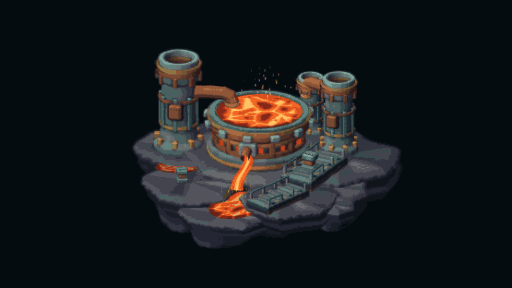
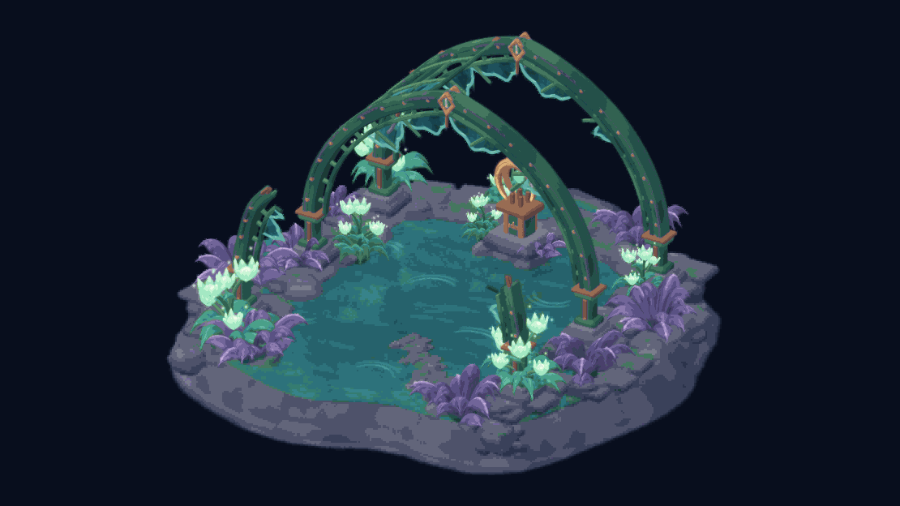
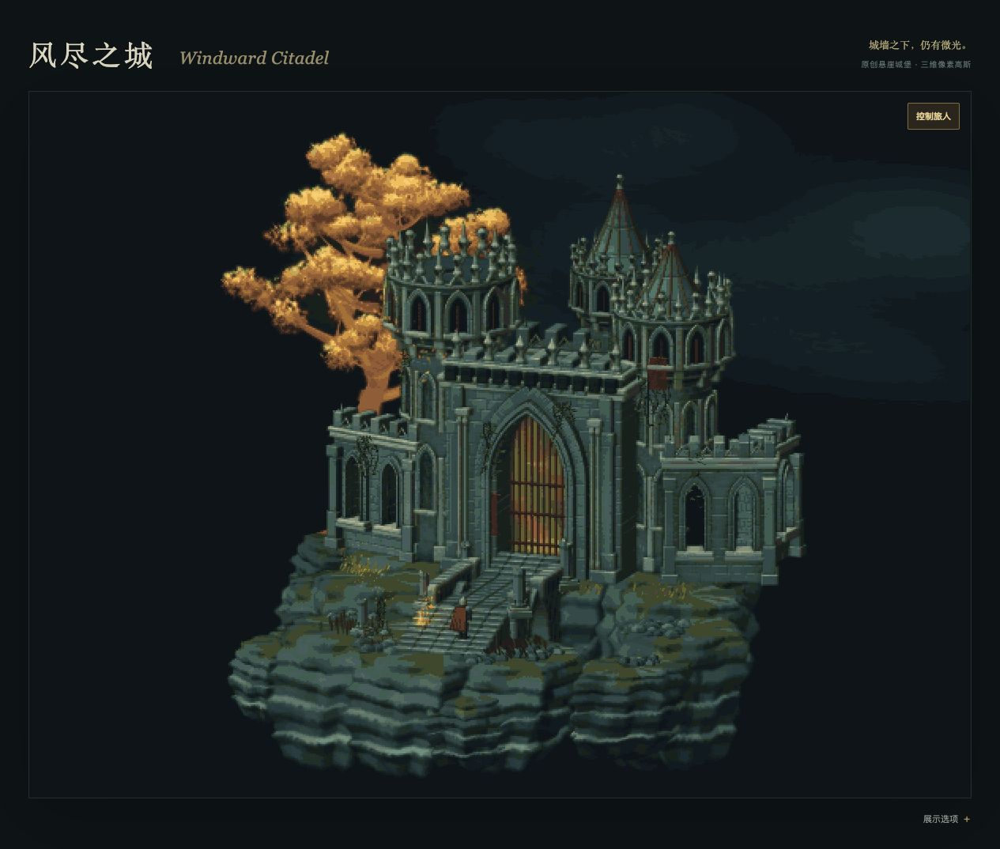

# Pixel Splat Game Assets Skill

English · [简体中文](README.zh-CN.md)

A Codex skill for producing reusable 3D pixel-art Gaussian splat assets from a reference image, video, or art brief. Each scene ships with individual `.splat` files, editable Gaussian data, and the source that generates them.

[](examples/frostline-beacon/)

## Demo gallery

Four original scenes contain **49 independent assets**. The interactive gallery lets you orbit each scene, inspect and download single assets, and export a matched pair of raw and pixel-art renders.

| Scene | What you can see or do | Assets |
| --- | --- | ---: |
| [Frostline Beacon](examples/frostline-beacon/) | Switch the beacon on and off. Watch the receiver turn and snow drift over the ridge. | 9 |
| [Ember Foundry](examples/ember-foundry/) | Inspect the copper furnace, molten runoff, and rising embers. | 9 |
| [Moonpool Conservatory](examples/moonpool-conservatory/) | Orbit vaulted ribs, luminous plants, and animated water with real-time reflections. | 9 |
| [Windward Citadel](examples/windward-citadel/) | Walk the stone bridge and steps as the traveler and interact with the ember. | 22 |

| Ember Foundry | Moonpool Conservatory | Windward Citadel |
| --- | --- | --- |
|  |  |  |

[Beacon off](examples/frostline-beacon/previews/beacon-off-pixel.png) · [Beacon raw frame](examples/frostline-beacon/previews/scene-raw.png) · [Windward Citadel motion clip](examples/windward-citadel/previews/windward-motion.mp4)

### Run locally

```sh
git clone https://github.com/leeyang1990/pixel-splat-game-assets-skill.git
cd pixel-splat-game-assets-skill
python3 -m http.server 8776 --bind 127.0.0.1
```

Open [Frostline Beacon](http://127.0.0.1:8776/#frostline-beacon) in a WebGL2 browser. Drag to orbit and scroll to zoom. When the canvas has focus, the arrow and plus/minus keys do the same. Expand **Assets and rendering (资产与出图)** to select one asset, switch render modes, or export both from the same frame.

- In **Frostline Beacon**, click **Beacon (信标)** or press **B** while the canvas has focus. Choose **Play motion (播放动态)** to see the dish turn and snow fall. Switching the beacon off dims the lens and stops the dish while snow keeps falling.
- In **Windward Citadel**, open **Playable version (进入可玩版)**, choose **Control traveler (控制旅人)**, then use **WASD** to move and **E** near the ember. The playable area covers the lower steps and bridge.

The prebuilt demos run from the static server. Build instructions are provided for [Frostline Beacon](examples/frostline-beacon/NOTICE.md), [Ember Foundry](examples/ember-foundry/NOTICE.md), [Moonpool Conservatory](examples/moonpool-conservatory/NOTICE.md), and [Windward Citadel](examples/windward-citadel/使用说明.md).

## Install the skill

From the cloned repository, copy the [make-game-assets](make-game-assets/) skill directory into your Codex skills directory.

```sh
mkdir -p ~/.codex/skills
cp -R make-game-assets ~/.codex/skills/
```

An example prompt follows.

> Use $make-game-assets to make an arctic harbor. Start with a dock segment, a mooring post, and water. Check them at the game camera size, then expand the set. Deliver each asset as a standalone .splat with editable data and generator source, plus an assembled scene.

Start with representative assets to check silhouette, scale, fit, and raw Gaussian rendering. Tune palette and pixel scale at the intended game camera, then expand the asset set. Reuse the export and validation process across themes. [Skill instructions](make-game-assets/SKILL.md) · [Scene-pack workflow](make-game-assets/references/scene-packs.md)

## Reuse and validate assets

- `manifest.json` maps each asset ID to its binary, editable data, bounds, and anchors.
- `scene.json` defines placements, the starting camera, and lighting. Each asset uses local coordinates with **+Y up** and **+Z forward**.
- `style.json` sets materials, the palette, and pixel settings. `src/` contains generators and any scene-specific behavior.

```sh
python3 make-game-assets/scripts/check_manifest.py examples/frostline-beacon/manifest.json
python3 make-game-assets/scripts/check_scene.py examples/frostline-beacon/manifest.json examples/frostline-beacon/scene.json
```

The manifest checker covers file layout, data and quantization, and bounds. The scene checker covers instance references, transforms, and the total Gaussian budget. The packs include render previews and validation records. The gallery was checked in a desktop WebGL2 browser. Measure performance and check imports separately in your target game engine.

[Provenance and licensing](NOTICE.md)
