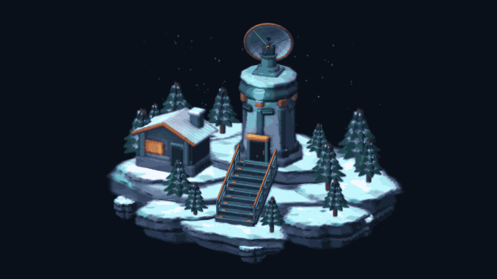
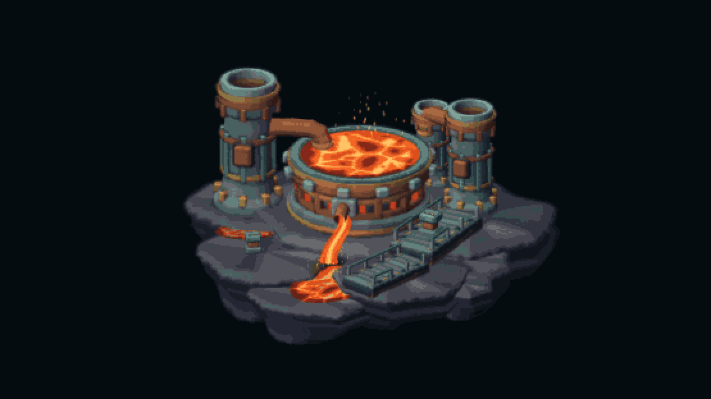
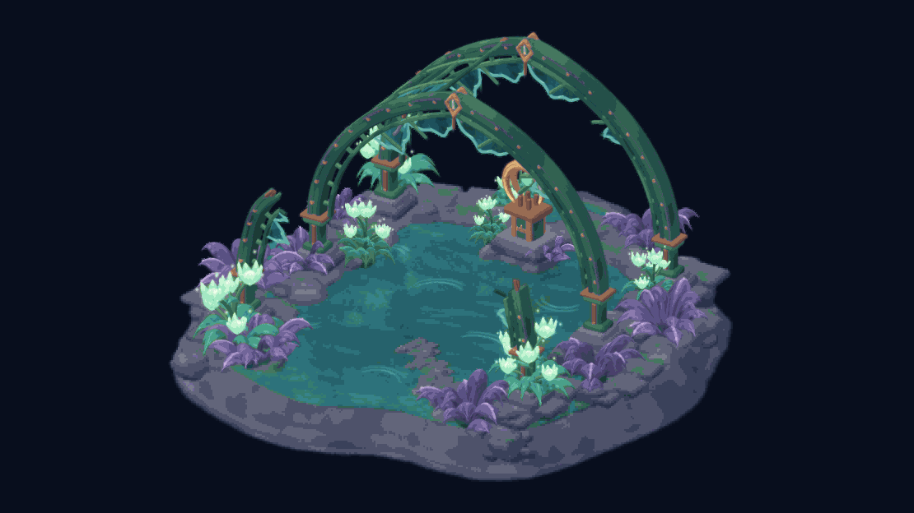
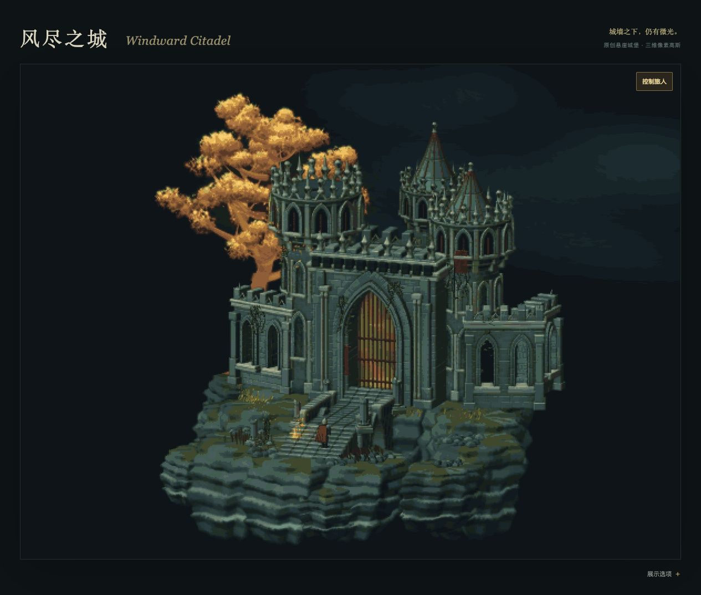

# 像素高斯游戏资产 Skill

[English](README.md) · 简体中文

面向游戏制作的 Codex Skill。把参考图、视频或美术需求变成可独立加载和拼装的 3D 像素风 Gaussian splat 资产。每个场景包都附独立的 `.splat`、可编辑高斯数据和生成源码。

[](examples/frostline-beacon/)

## 场景集

四套原创场景共有 **49 件独立资产**。在交互展示页可以转动镜头、单独检查和下载资产，以及导出同一帧的原始高斯与像素图。

| 场景 | 画面与交互 | 独立资产 |
| --- | --- | ---: |
| [暮雪信标](examples/frostline-beacon/) | 开关雪岭信标，查看天线转动、灯光和飘雪。 | 9 |
| [熔潮铸炉](examples/ember-foundry/) | 检查铜制炉体、发光熔流和上升火星。 | 9 |
| [月汐温室](examples/moonpool-conservatory/) | 查看玻璃断拱、发光水生植物、动态水波和实时倒影。 | 9 |
| [风尽之城](examples/windward-citadel/) | 控制旅人走过石桥和台阶，靠近余火进行交互。 | 22 |

| 熔潮铸炉 | 月汐温室 | 风尽之城 |
| --- | --- | --- |
|  |  |  |

[信标熄灭图](examples/frostline-beacon/previews/beacon-off-pixel.png) · [信标原始高斯](examples/frostline-beacon/previews/scene-raw.png) · [风尽之城动态演示](examples/windward-citadel/previews/windward-motion.mp4)

### 本地查看

```sh
git clone https://github.com/leeyang1990/pixel-splat-game-assets-skill.git
cd pixel-splat-game-assets-skill
python3 -m http.server 8776 --bind 127.0.0.1
```

在支持 WebGL2 的浏览器中打开 [暮雪信标](http://127.0.0.1:8776/#frostline-beacon)。拖动旋转，滚轮缩放。画面获得焦点后也可以用方向键和加减键操作。展开「资产与出图」可单独查看资产、切换出图模式并导出同帧对照。

- 在**暮雪信标**中，点击「信标」，或在聚焦画面时按 **B**。打开「播放动态」可看到天线转动和飘雪。关闭信标后，透镜变暗，天线停下，飘雪继续。
- 在**风尽之城**中，进入「可玩版」后点击「控制旅人」，用 **WASD** 移动，靠近余火按 **E**。可行走区域覆盖下段石阶和桥面。

静态服务可以直接加载仓库里预生成的资产。重建命令见 [暮雪信标说明](examples/frostline-beacon/NOTICE.md)、[熔潮铸炉说明](examples/ember-foundry/NOTICE.md)、[月汐温室说明](examples/moonpool-conservatory/NOTICE.md)和[风尽之城说明](examples/windward-citadel/使用说明.md)。

## 安装与使用

克隆仓库后，将整个 [make-game-assets](make-game-assets/) 目录放进本机 Codex 的 skills 目录。

```sh
mkdir -p ~/.codex/skills
cp -R make-game-assets ~/.codex/skills/
```

在新对话中可以这样调用。

> 用 $make-game-assets 做一座寒带港口。先做一段码头、系缆柱和水面，在实际游戏镜头大小下检查，再扩展成港口资产包。每件交付独立 .splat、编辑数据和生成源码，再给一套组合场景。

先从代表样件入手，验证轮廓、比例、装配和原始高斯。在实际游戏镜头里调整色板和像素网格，再扩展同系列资产。换题材时复用导出和验收流程。 [Skill 指令](make-game-assets/SKILL.md) · [多场景工作流](make-game-assets/references/scene-packs.md)

## 资产复用与验收

- `manifest.json` 提供资产 ID、二进制、编辑数据、边界和挂点。
- `scene.json` 定义实例摆放、默认镜头和灯光。资产采用各自局部坐标，**+Y 向上、+Z 朝前**。
- `style.json` 保存材质和像素出图参数。`src/` 包含生成器和场景行为代码。

```sh
python3 make-game-assets/scripts/check_manifest.py examples/frostline-beacon/manifest.json
python3 make-game-assets/scripts/check_scene.py examples/frostline-beacon/manifest.json examples/frostline-beacon/scene.json
```

清单检查器核对文件布局、数据量化及边界。场景检查器核对实例引用、变换和实例高斯总量。各包附预览图和验证记录。展示页已在桌面 WebGL2 浏览器验证，游戏引擎接入和运行性能按目标环境实测。

[来源与许可](NOTICE.md)
